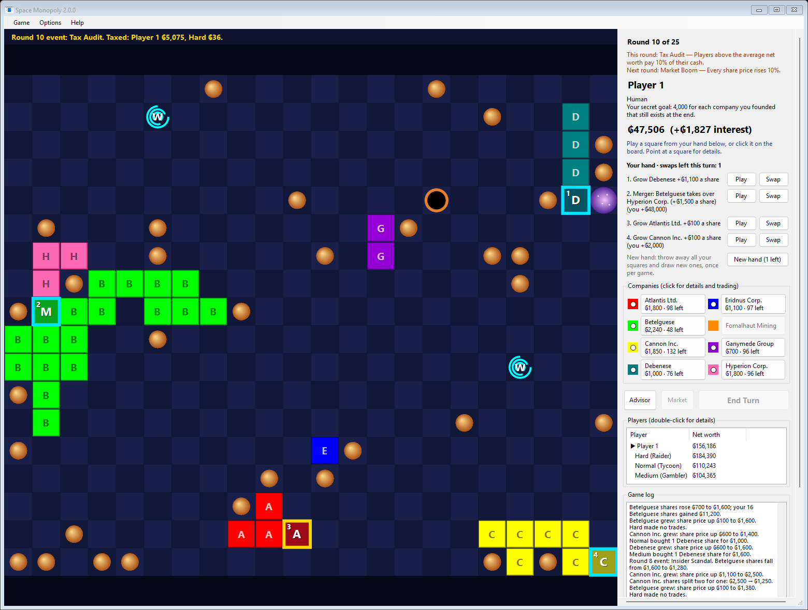
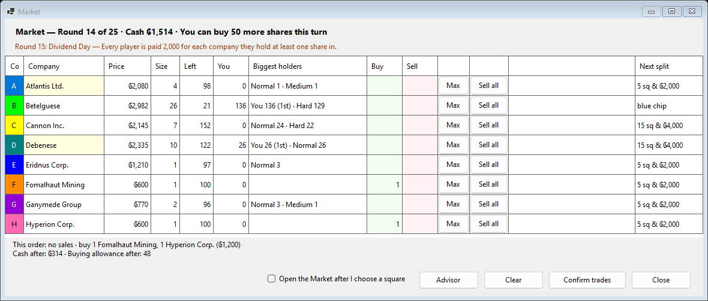
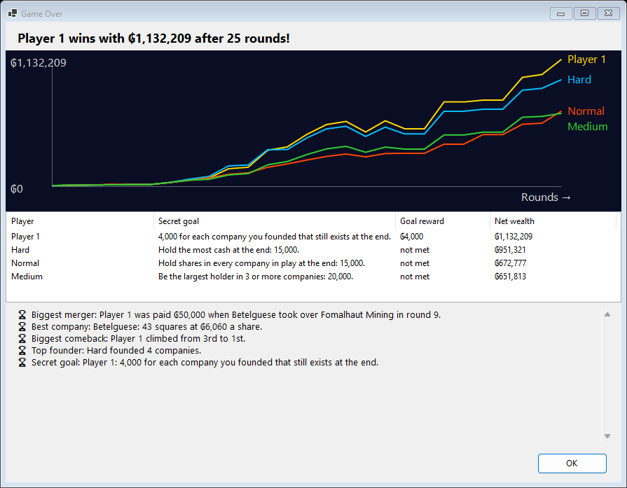
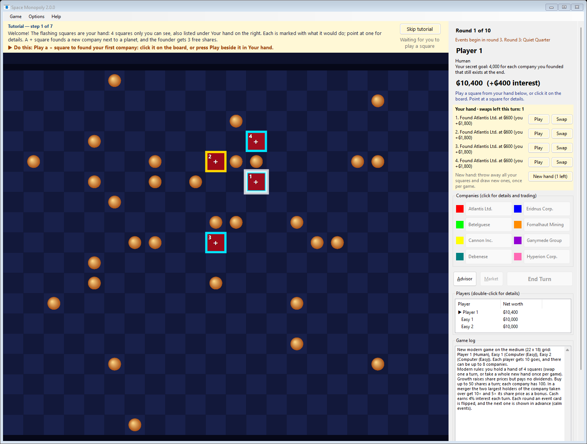

# Space Monopoly 2.0

**The classic freeware share-trading game is back, rebuilt for Windows 11, with a brand-new Modern game you can finish in a lunch break.**



Back in 1998, David Vivash wrote *Space Monopoly*, a little freeware game about founding companies among the stars and getting rich trading their shares. Its source code was later released under the GNU GPL v2.

**Space Monopoly 2.0** brings it back. The whole game has been rebuilt from the original Borland C++ source in modern C# and .NET 9. It runs sharp and smooth on today's high-resolution screens, and it comes with opponents who actually play back: four levels of computer player, four personalities, and even **Claude**, Anthropic's AI, sitting at the table and explaining its moves as it goes.

The original rules are all still here as **Classic** and **Tournament**. The headline act, though, is **Modern**: a faster, tenser and fairer game, designed so that a solo game against the computer takes 15–30 minutes and nobody is out of it until the very end.

[**⬇ Download the latest release**](https://github.com/SparkeyinVA/Space-Monopoly/releases/latest). It's a single portable `SpaceMonopoly.exe` (about 50 MB): no installer, and nothing else to install. Put it anywhere, even on a USB stick, and double-click.

---

## Why Modern is the version to play

The 2001 game was charming, but most turns played themselves. Five random squares were dealt each turn, the best buy was always the cheapest company, cash was worthless, and whoever got ahead early piled up a fortune in the quintillions. **Modern** keeps the heart of the game and gives every turn a real decision.

### 🃏 A hand you can plan with
You hold **4 private squares**. Each one shows on the board exactly what it would do before you play it: grow a company, merge two, or found a new one, with the share price change and every player's gain. Keep the merger square until you're ready, **swap** a square you don't want, **discard** one after trading, or take a **whole new hand** once a game.

### 🏆 Majorities matter
When two companies meet, the bigger one takes over the smaller, and the smaller company's **two largest shareholders collect a bonus** worth many times its share price. Racing an opponent to become the biggest holder of a company you know is about to be swallowed is the best feeling in the game. You can even roll your payout straight into shares of the winner.

### 📈 Scarce shares, real money
Each company starts with just 100 shares, and you can buy only 50 shares a turn. Companies split as they grow, and the bonuses grow with them. **Cash earns interest**, so holding back is a real choice, not a mistake.

### 🌠 Luck you can see coming
From round 3 an **event card** turns every round: a Pirate Raid, a Market Boom, a Solar Flare, a Dividend Day. **Next round's card is always shown in advance**, so you can get ready for it. Choose Calm, Standard or Wild for as much chaos as you like.

### 🔄 Nobody is out of it
The player in last place gets an extra, helpful square. Rare events help whoever is behind. Every player has a **secret goal** that's revealed at the end, and companies pay their top holders a final payout. Winners are often decided in the last few rounds.

### 🌌 A stranger galaxy
Modern boards include a **nebula** (double planet bonus), a **black hole** (nothing can be played beside it) and a pair of **wormholes** that let companies grow and merge right across the board.



---

## Opponents worth beating

| Opponent | How it plays |
|---|---|
| **Easy** | Learning the ropes. Mostly random. |
| **Medium** | A fair, everyday opponent. |
| **Normal** | A step up: looks ahead at every square and its follow-up trades. |
| **Hard** | The expert. Simulates every option and races you for majorities. |
| **Claude** | Anthropic's Claude plays through Claude Code, plans ahead from turn to turn and comments on its moves in the game log. |

Give the computer players a **personality** (Raider, Tycoon, Hoarder or Gambler) and each one plays in its own style. Turn on **Adaptive difficulty** and the opponents step up each time you win and ease off each time you lose. Stuck? The **Advisor** button shows what the Hard player would do, and why.

## Made for coming back to



- **Game Over chart:** every player's net worth, round by round, plus awards for the biggest merger, the best company and the biggest comeback.
- **Daily Challenge:** the same board and the same deal for everyone, all day. Can you beat your best?
- **Achievements**, high-score tables for every grid size and game type, and an **8-player hot seat** for friends.
- **A guided tutorial** (Help > Tutorial) teaches Modern in about five minutes, and short tips explain each new rule the first time you meet it.



---

## What's new since David Vivash's version 1.2 (2001)

**Rebuilt for today**
- Rewritten in C# / .NET 9 WinForms from the original Borland C++ Builder 3 source, and sharp at any display scaling, including multi-monitor set-ups with different scaling.
- Ships as one portable `.exe`. Settings, high scores and achievements are kept in `%LOCALAPPDATA%\SpaceMonopoly`.
- The board scales to the window, and company letters are drawn on every square for colour-blind players.

**New game type: Modern** (all of the above): a hand of squares with swap, discard and New hand; a 25-round game; majority bonuses and conversion into survivor shares; limited shares and buying; size-and-price splits; interest on cash; the events deck with Chaos settings; secret goals, final payouts and catch-up help for last place; special squares.

**New opponents and help**
- Computer players at four levels (Easy, Medium, Normal, Hard) with four personalities, plus Claude players.
- Adaptive difficulty, the Advisor (with an optional plain-English explanation from Claude), and the tutorial and first-time tips.

**New ways to play and look back**
- Previews on every square: what it does and what each player gains.
- A Market window to trade every company in one order, with Max and Sell all buttons.
- A news line and game log instead of pop-up boxes, and a Fast setting for computer players.
- The Game Over chart and awards, the Daily Challenge, achievements and high scores for each game type.
- How to Play written for the game type you're playing.

**Classic and Tournament, faithfully kept, with fixes**
- Shares in a company that's taken over now go to zero, instead of still counting towards your net worth.
- Mergers in Tournament games now convert your shares.
- A share price of ₲6,400 or more now splits repeatedly, not just once.
- The game no longer hangs when fewer than five squares are left to offer.
- Every player gets the full number of goes, the game ends cleanly once no new company can be formed, and the grids allow 5 / 8 / 12 companies.
- No upper limit on money: fortunes of a quintillion or more are written out in words.
- Starting a new game really does clear the old companies now.

---

## How to play

1. **Start a game:** *Game > New Game*. Add the players in turn order (yourself, plus any computer or Claude players), pick **Modern**, and click **Go!** New to the game? Try *Help > Tutorial* first.
2. **Play a square:** your hand flashes on the board and is listed under **Your hand**. Point at a square to see what it would do, then click it or press **Play**.
   - Next to a planet or star (and no company): **found** a company and get free shares.
   - Next to one company: it **grows**, and its share price rises.
   - Next to two or more companies (an **M** square): they **merge**. The bigger one takes over, and the smaller one's top two holders get a bonus.
3. **Trade:** press **Market** (or M) to buy and sell any company in one order, up to 50 shares bought a turn. Leftover cash earns interest.
4. **End your turn:** optionally **Discard** a square you don't want, then press **End Turn**.
5. **Win:** after 25 rounds, final payouts and secret goals are added up. The highest net worth (cash plus shares) wins.

The full rules for each game type are in *Help > How to Play*. Not sure what to do? Press **Advisor**.

### Playing against Claude

Claude players use **Claude Code** with your existing Claude login, so no API key is needed. Install Claude Code, sign in once, then add a *Claude* player in New Game. *Options > Preferences > Claude* sets the model and checks the connection. Each Claude move takes about 10–30 seconds and counts toward your Claude plan's usage. Turn on "Ask Claude only on key turns" for quicker games.

---

## Build and run it yourself in Visual Studio 2022

**You'll need**
- Windows 10 or 11.
- **Visual Studio 2022**, version 17.12 or later, with the **.NET desktop development** workload. This includes the .NET 9 SDK.

**Steps**
1. Clone the repository, or download it with *Code > Download ZIP* and unzip it.
2. Open `SpaceMonopoly.NET\SpaceMonopoly.sln` in Visual Studio 2022.
3. In Solution Explorer, right-click **SpaceMonopoly.WinForms** and choose **Set as Startup Project** (it usually is already).
4. Choose **Debug** or **Release** in the toolbar and press **F5** to build and play.
5. To run the tests, choose *Test > Run All Tests* (Test Explorer). There are 140+ tests covering the rules, the computer players and the tutorial.

**From the command line** (in the `SpaceMonopoly.NET` folder):

```powershell
dotnet run --project SpaceMonopoly.WinForms -c Release    # build and play
dotnet test                                               # run the tests
```

**Make your own portable build:** one self-contained `SpaceMonopoly.exe` that runs on any 64-bit Windows PC with nothing else installed:

```powershell
dotnet publish SpaceMonopoly.WinForms -c Release -r win-x64 --self-contained true -p:PublishSingleFile=true -p:IncludeNativeLibrariesForSelfExtract=true -p:EnableCompressionInSingleFile=true -p:DebugType=none -o publish
```

The game's version number is set by `<Version>` in `SpaceMonopoly.WinForms\SpaceMonopoly.WinForms.csproj`. It's shown in the title bar and in *Help > About*.

More developer notes, including the project layout and the balance tool, are in [`SpaceMonopoly.NET/README.md`](SpaceMonopoly.NET/README.md).

---

## What's in this repository

| Folder | What it is |
|---|---|
| [`SpaceMonopoly.NET/`](SpaceMonopoly.NET/README.md) | **Space Monopoly 2.0**, the Windows 11 edition by Jerame Chamberlain. |
| `sourceCode/spacemonopoly/` | The original Borland C++ Builder 3 source code (v1.2) with its Mercurial history. |
| `Web/` | A saved copy of the original website (http://space.monopoly.iwarp.com/), including the 1999 and 2001 executables and documentation. |
| `wiki/`, `issues/`, `discussions/`, `releases/` | The CodePlex project export from 2017. |
| `docs/images/` | The screenshots in this README. |

The original `Space Monopoly v1.2.exe` inside `Web/…_files/SpaceDocs2.zip` still runs on Windows 11, if you'd like to see where it all began.

## Credits and licence

- **Original game:** © 1998–2001 David Vivash. *"Heck, I never said it was real life..."*
- **Space Monopoly 2.0, the Windows 11 edition:** Jerame Chamberlain, built with Claude Code.

Space Monopoly is free software, released under the **GNU General Public License v2**, the same licence as the original. See [`LICENSE`](LICENSE).
